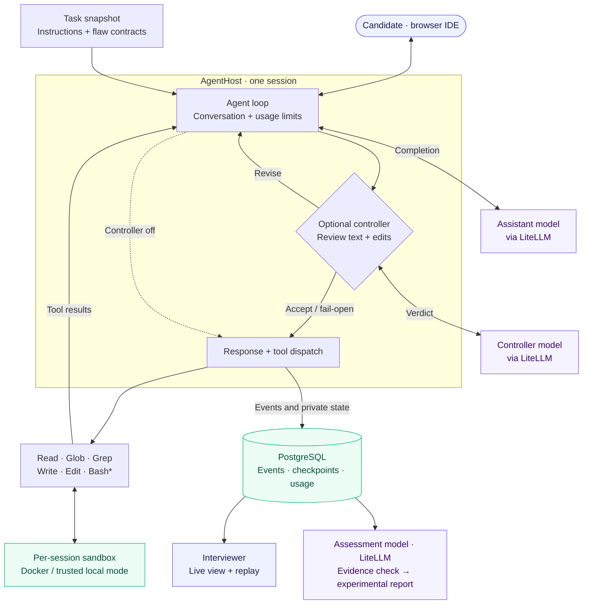

# Vibony

**A self-hostable interview platform for exploring how engineers diagnose and correct
AI-generated mistakes.** A candidate
solves an engineering task in a browser IDE with an AI assistant; the interviewer
either watches live or reads an AI-generated assessment of the session afterwards.

> Observe how a candidate works with an AI assistant: what they question, how they
> investigate, and how they verify a proposed fix.


*Real candidate UI with scripted dialogue, file changes and simulated streaming.
The current backend delivers complete replies; the gradual text reveal is a demo-only
effect. No live model calls or measured quality results are shown.*
[Still image](docs/media/candidate-demo.png) · [Reproduce the capture](docs/media/README.md)

---

## The idea

An important part of working with AI is **catching it when it's confidently wrong** —
the missing ownership check, the
race that only shows under load, the checkpoint that silently drops optimizer state.

In an ordinary AI-assisted interview, whether the candidate gets a chance to catch a
particular mistake depends on the model's output. Different candidates may encounter
different problems.

Vibony's answer is the **trap-control mechanism**. Each task ships a small contract of
planted flaws (`expected_ai_pitfalls`). An optional **controller model** reviews proposed
assistant text and `Write`/`Edit` calls before they reach the candidate or execute.
The intended behavior is for the interview AI to:

- **commit the planted flaw** by default (a passive or vague candidate gets the buggy version),
- **hold the flaw** under weak pushback ("just redo it"),
- **concede and fix it** after the candidate *correctly names* the problem.

This is an experimental mechanism, not a guarantee. The controller is off unless
`VIBONY_CONTROLLER_MODEL` is configured with an allowed model and its provider
credentials. While any trap remains locked, the assistant cannot execute `Bash`;
file changes use the reviewed `Write`/`Edit` tools. The candidate can still use the
terminal. Controller errors or exhausted retries can let an unchecked or rejected
proposal through; such sessions are flagged and their automated assessment is withheld. The reference tasks use plausible flaws, such as omitting optimizer state
from a training checkpoint.

The rest of the platform — the browser IDE, the per-session sandbox, the event-sourced
replay, the AI assessment — is the vehicle for running that mechanism end to end.

---

## Evaluation status

**Quality has not been established by a comprehensive benchmark.** Limited exploratory
checks have been performed, but there is no representative, repeated evaluation across
the task corpus and supported models. Broader benchmarking is deferred because it
requires a budget for paid model calls.

The repository includes an evaluation harness and automated software tests. Passing
those tests does **not** establish the controller's behavioral reliability, the
accuracy of AI-generated assessments, or the validity of this approach for evaluating
candidates. No aggregate quality scores or model-comparison claims are published.
AI-generated assessments are experimental and should be reviewed by an interviewer.

---

## How an interview works

1. The interviewer creates a session for a task and gets a candidate invite link.
2. The candidate opens the link in any modern browser, enters their name, and starts. The IDE has:
   - **Monaco editor + file tree** over a per-session sandbox,
   - **AI chat** with task-specific instructions and an optional controller,
   - **xterm console** (and `!cmd` in chat) for shell commands inside the sandbox.
3. In **live mode** the interviewer watches the session in real time; in **async mode** a
   timer runs, no one watches, and an AI assessment is generated when the candidate submits.
4. The interviewer replays recorded messages and file changes from the event log.
   Interrupted or failed persistence is treated as incomplete evidence.

The platform is **language- and stack-agnostic** — a task declares its `runtime_image`,
so backend, frontend, ML, and data-analysis tasks each run on the right sandbox image.
The repo ships two reference tasks with their trap contracts: an ML training loop
(`task-01-training-loop`) and a concurrent seat-reservation service
(`task-02-seat-reservation`).

---

## Architecture



*Agent Bash is available only after all controlled traps are unlocked (or when the
controller is disabled). The candidate’s terminal remains available.*

The controller reviews proposed text and `Write`/`Edit` operations before dispatch.
It is an experimental behavior check, not a security boundary. Sandbox isolation
is separate. Assessment runs after the session ends and uses its recorded evidence. Its quota is
separate from the shared assistant/controller/compaction quota. No numeric quality
claim follows from this architecture.

| Component | Stack |
|---|---|
| **Backend** | FastAPI + PostgreSQL — session lifecycle, the per-session agent loop (`AgentHost`), the sandbox provider, the LLM proxy, multi-tenant auth |
| **Dashboard** | React + Vite + TypeScript — interviewer admin, candidate IDE, replay viewer |
| **Sandbox** | A Docker container per session, language-specific image, optional gVisor (`runsc`) kernel isolation, default-deny network |
| **LLM** | DeepSeek by default; Anthropic / OpenAI / any OpenAI-compatible provider via `litellm` |

Two design decisions carry most of the weight:

- **The event log is the source of truth for the sandbox filesystem.** The container is
  ephemeral; on a backend restart it's re-created from the task baseline and re-hydrated
  by replaying `file_changed` events, so candidate edits survive.
- **A stable `SandboxProvider` interface** keeps swapping the execution backend (local dev
  shortcut → Docker → a future fleet) an implementation change, not a rewrite.

Full write-up: [docs/architecture.md](docs/architecture.md).

---

## Self-host quick-start

Requirements: Docker + Docker Compose, and an API key for one LLM provider.

```bash
git clone https://github.com/Kolyanty/vibony.git vibony
cd vibony
cp backend/.env.example backend/.env
```

Edit `backend/.env` and set a model plus its provider key — for example:

```bash
VIBONY_DEFAULT_MODEL=deepseek/deepseek-chat
DEEPSEEK_API_KEY=sk-...
```

Then bring the stack up:

```bash
docker compose up --build  # postgres + backend (:8000) + dashboard (:5173)
```

Open **http://localhost:5173**, sign up (this creates your workspace and an admin
account — no invite needed), create a **live** session for **task-02-seat-reservation**, and open the candidate link.
This task uses only Python’s standard library. Check the sandbox with
`python -c "import app, store; print('Task modules loaded')"` in the candidate terminal,
then follow `task.md`: implement `reserve(...)` in `app.py` and exercise it with a `Store` containing
a small stock pool, including concurrent calls.
The initial `NotImplementedError` is intentional. Interviewer notes and the reference
solution stay outside the candidate bundle.
You can explore the UI without a provider key; sending an AI message requires one.

Notes:

- The dev `backend/.env.example` ships an **insecure** session secret so the stack boots
  out of the box. Generate your own before any shared deploy:
  `python -c "import secrets; print(secrets.token_hex(32))"`.
- Migrations run automatically on backend startup (`alembic upgrade head`).
- The dashboard checks its saved dependencies against `package.json` and
  `package-lock.json` at startup, running `npm ci` when they change. After pulling
  dependency updates, run `docker compose up -d --build --force-recreate dashboard`.
  The first start after an update may take longer while packages are installed.
- Reference tasks are synchronized at startup. Removed or renamed templates disappear
  from the task picker; existing sessions retain their original task records.
  Workspace-owned copies are unchanged.
- Email verification is not a login gate; the default `console` email backend just logs
  the link, so no SMTP is needed to try the app.
- The candidate sandbox runs in **local mode** out of the box (no Docker image build).
  This executes candidate commands inside the backend container, without per-session
  isolation; use it only with trusted local input. For isolated sessions, build the
  shipped images and switch the provider:
  ```bash
  docker build -t vibony/sandbox-py:3.12 sandbox/images/py
  docker build -t vibony/sandbox-node:20 sandbox/images/node
  # then set VIBONY_SANDBOX_PROVIDER=docker in backend/.env
  ```
  Recreate the backend after changing its environment: `docker compose up -d --force-recreate backend`.
- Run **one backend worker**. The broker, active hosts, timers and rate limiter are
  process-local; multiple workers/replicas are not supported.
- `docker-compose.prod.yml` is an unverified Linux deployment template, not a tested
  production quick-start. Production requires Docker isolation and a PostgreSQL URL
  with TLS verification; the bundled Postgres service does not provision certificates.
  Use an external TLS-configured database or supply that configuration yourself.

### Enable the optional controller

For the assistant example above, add to `backend/.env`:

```dotenv
VIBONY_CONTROLLER_MODEL=openai/gpt-4o-mini
VIBONY_MODEL_ALLOWLIST=deepseek/deepseek-chat,openai/gpt-4o-mini
OPENAI_API_KEY=your-provider-key
```

Recreate the backend, then create a **new** session. Configuration is captured at the
first agent start; changing a task or environment does not rewrite an existing
session’s task/prompt/controller snapshot. This is a configuration example, not a
benchmarked model recommendation. Controller reviews and retries incur extra costs;
see the session and assessment limits in `backend/.env.example`.

---

## Repository layout

```
backend/    FastAPI backend — sessions, AgentHost, DockerSandboxProvider, LLM proxy, auth
dashboard/  React SPA — interviewer dashboard, candidate IDE, replay viewer
sandbox/    Dockerfiles for the shipped runtime images (Python, Node)
tasks/      Reference interview tasks with their trap contracts
configs/    global.yaml — the baseline weakness preamble applied to every task
docs/       Architecture + wire-protocol contracts + task-design guide
```

---

## Documentation

- [docs/architecture.md](docs/architecture.md) — platform architecture end to end.
- [docs/protocol/](docs/protocol/) — the wire contracts (events, WebSocket frames, session
  config, task format, `Toolset`, `SandboxProvider`) that backend and dashboard both follow.
- [docs/task-design/format.md](docs/task-design/format.md) — what makes a good vibe-coding
  task, the anti-patterns, and the controlled-trap contract.
- [docs/weakness-format.md](docs/weakness-format.md) — the weakness YAML that configures the
  assistant per task.

---

## Development checks

See [CONTRIBUTING.md](CONTRIBUTING.md) for workflow, task authoring and dependency audits.

Backend development requires Python 3.12 or 3.13, Poetry, and local PostgreSQL 16
binaries (`pg_ctl` and `initdb`). Tests start their own temporary database; a running
Compose database is not used. Put PostgreSQL's binaries on PATH or set `PGCTL` to the
absolute `pg_ctl` path.

```bash
cd backend
poetry install --with dev
poetry run pytest -q -ra
poetry build
```

Six sandbox integration tests require a running Docker daemon and the Python sandbox
image. Build it from the repository root before running the suite:

```bash
docker build -t vibony/sandbox-py:3.12 sandbox/images/py
```

For the dashboard, use Node.js 20 (see `dashboard/.nvmrc`):

```bash
cd dashboard
npm ci
npm run lint -- --max-warnings=0
npm run test
npm run build
```

[CI](.github/workflows/ci.yml) runs on pull requests, pushes to `main`, and manual
dispatch. It provisions PostgreSQL, runs backend tests excluding Docker integration
tests, builds the Python package, and checks dashboard lint, tests and production
build. Tests mock LLM calls and require no provider API keys. Run Docker integration
tests and dependency audits locally using the commands above and in CONTRIBUTING.md.

---

## Status & license

This is an **engineering / portfolio project**, published as source you can read and
self-host — not a hosted service. It runs end to end locally without any cloud deploy.

Licensed under [Apache-2.0](LICENSE).
